# Лабораторная работа №6. Система контроля версий

**Выполнила:** Маршадес Л.Р., группа 4541в

**Цель работы:** изучение базовых возможностей системы управления версиями, опыт работы с Git API, опыт работы с локальным и удалённым репозиторием.

**Репозиторий:** https://github.com/iL0K0/LR6

## Ход работы

### 1–3. Аккаунт, форк и установка Git

Использован существующий аккаунт GitHub `iL0K0`. Сделан форк репозитория `Kurtyanik/LR6` со всеми ветками. Git был установлен ранее.

### 4–5. Настройка клиента и клонирование

Личный репозиторий скопирован на компьютер командой `git clone`. Имя пользователя и email заданы через `git config` для этого репозитория.

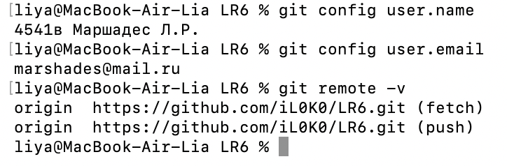

### 6. Добавление файла через GitHub

Через веб-интерфейс GitHub в ветку `master` добавлен файл `file.txt`. Затем изменения получены в локальный репозиторий командой `git pull`.

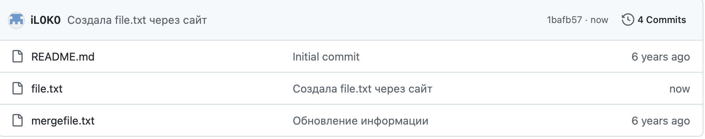

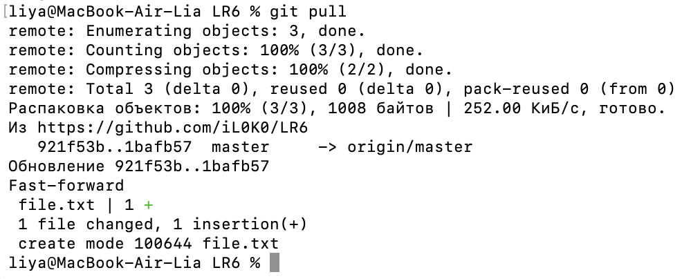

### 7. История операций веток

История каждой ветки просмотрена командой `git log --oneline`, а общая схема веток — командой `git log --oneline --graph --all`.

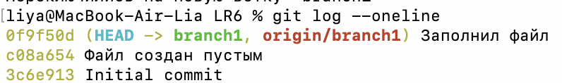

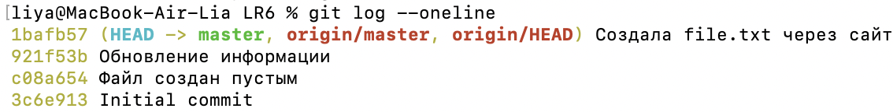

### 8. Последние изменения

Последний коммит просмотрен командой `git log -1 --stat`, а различия файла `mergefile.txt` между ветками — командой `git diff`.

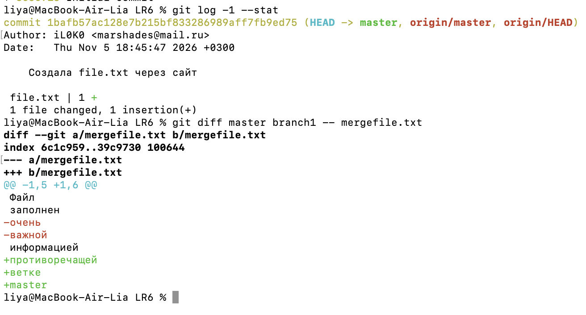

### 9. Слияние в master и разрешение конфликта

Слияние запущено командой `git merge branch1` из ветки `master`. Обе ветки изменили одни и те же строки файла `mergefile.txt`, поэтому возник конфликт.

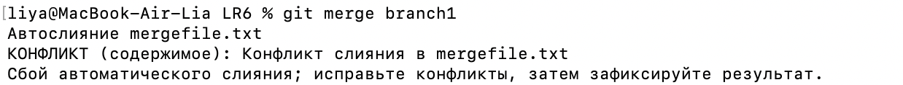

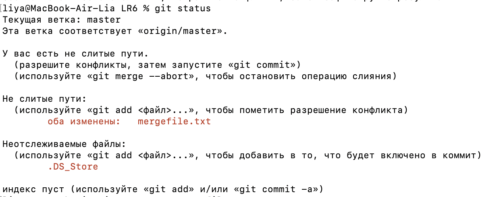

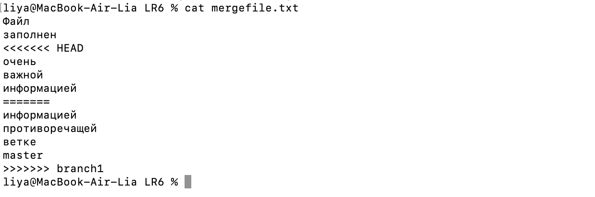

Файл отредактирован в Visual Studio Code: значки конфликта удалены, текст обеих версий сохранён. Затем файл добавлен командой `git add`, и слияние зафиксировано коммитом.


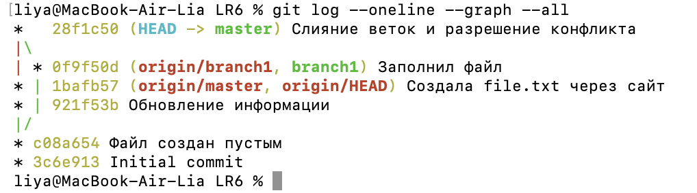

### 10. Удаление побочной ветки

После слияния локальная ветка `branch1` удалена командой `git branch -d`.

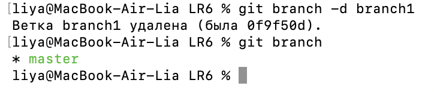

### 11. Изменения и их фиксация

В файл `notes.txt` несколько раз внесены изменения, каждое зафиксировано отдельным коммитом с комментарием.

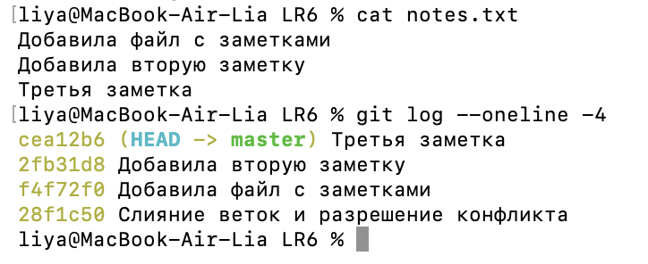

### 12. Откат коммита

Последний коммит отменён командой `git revert`. Она создаёт новый коммит с обратными изменениями и не удаляет старый из истории.

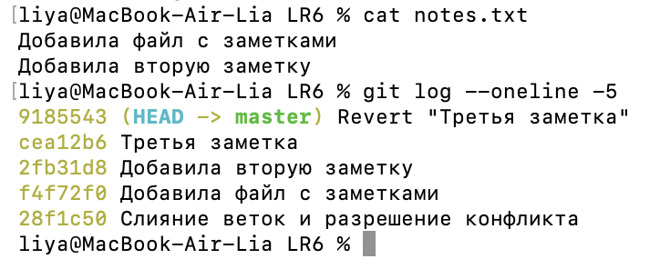

### 13. Ветка для отчёта

Командой `git checkout -b report` создана ветка `report`, в которой оформлен этот отчёт.
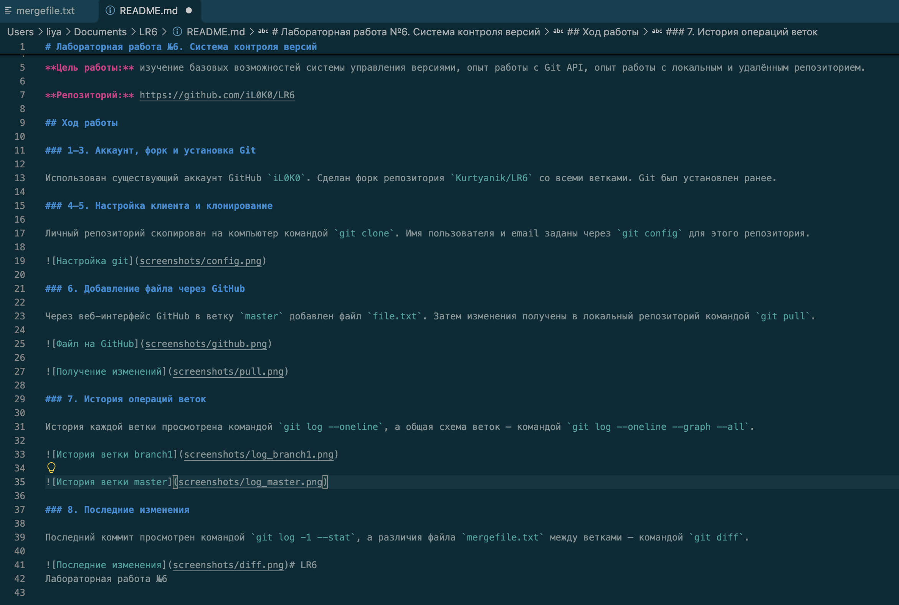

### 14. Лог команд

```bash
cd ~/Documents
git clone https://github.com/iL0K0/LR6.git
cd LR6
git config user.name "4541в Маршадес Л.Р."
git config user.email "marshades@mail.ru"
git config user.name
git config user.email
git remote -v
git branch -a
ls
git pull
ls
git checkout branch1
git log --oneline
git checkout master
git log --oneline
git log --oneline --graph --all
git log -1 --stat
git diff master branch1 -- mergefile.txt
git merge branch1
git status
cat mergefile.txt
open -a "Visual Studio Code" mergefile.txt
cat mergefile.txt
git add mergefile.txt
git commit -m "ваш комментарий о слиянии и конфликте"
git log --oneline --graph --all
cat mergefile.txt
git add mergefile.txt
git commit --amend -m "Слияние веток и разрешение конфликта"
git log --oneline --graph --all
git branch -d branch1
git branch
echo "пока" > notes.txt
git add notes.txt
git commit -m "комментарий 1"
git add notes.txt
git commit -m "комментарий 2"
git add notes.txt
git commit -m "комментарий 3"
echo "комментарий 2" >> notes.txt
git add notes.txt
git commit -m "комментарий 2"
echo "комментарий 3" >> notes.txt
git add notes.txt
git commit -m "комментарий 3"
cat notes.txt
git log --oneline -4
git revert --no-edit HEAD
cat notes.txt
git log --oneline -5
git reset --hard 28f1c50
echo "Добавила файл с заметками" > notes.txt
git add notes.txt
git commit -m "Добавила файл с заметками"
echo "Добавила вторую заметку" >> notes.txt
git add notes.txt
git commit -m "Добавила вторую заметку"
echo "Третья заметка" >> notes.txt
git add notes.txt
git commit -m "Третья заметка"
cat notes.txt
git log --oneline -4
git revert --no-edit HEAD
cat notes.txt
git log --oneline -5
git checkout -b report
mkdir screenshots
open screenshots
open -a "Visual Studio Code" README.md
git add screenshots
git add README.md
git commit -m "Начала делать отчет"
history -200
open -a "Visual Studio Code" README.md
open screenshots
git config user.name
git config user.email
git remote -v
git add screenshots
git commit -m "Добавила скриншоты для отчёта"
git add README.md
git commit -m "Начала делать отчет"
git add README.md
git commit -m "Описала в отчёте шаги с 9 по 13"
git add README.md
git commit -m "Добавила в отчёт лог команд"
git log --pretty=format:"%h %ad %an %s" --date=short
git add README.md
git commit -m "Финальная фиксация отчёта"
git push origin master
git push origin report
git push origin --delete branch1
```